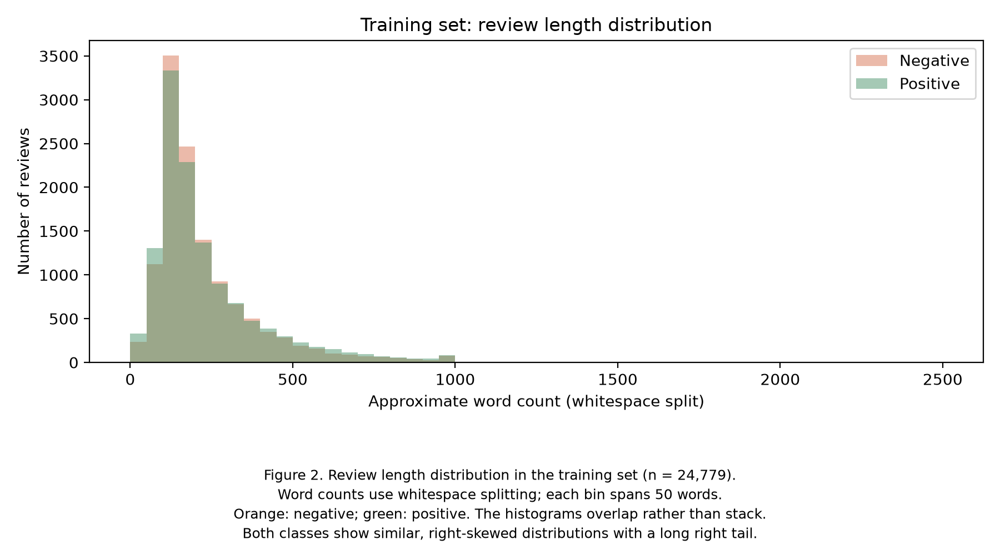
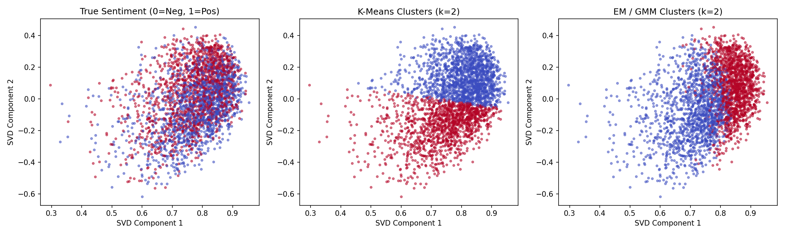
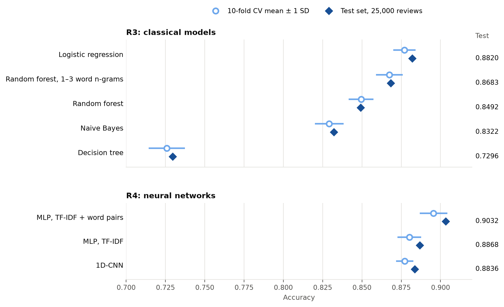

# Machine Learning-Based Sentiment Classification for IMDb Movie Reviews

## Group name

DL_Group_9

## Group members

* Xiangxi Shu
* Dani Haritz Leozarin
* Zihan Yang
* Enze ZHOU
* Junqiang Zhu

## Objectives

* Classify English movie reviews as expressing either positive or negative sentiment (Binary Classification).
* Apply unsupervised clustering (k-means, EM) to observe whether reviews naturally group by sentiment or other underlying factors (e.g., movie genre).
* Evaluate the impact of different text preprocessing and representation methods (e.g., term frequency counts vs. preserving word order) on model performance.
* Compare the performance of classical machine learning models (Naive Bayes, Logistic Regression, Decision Trees, Random Forests) on the same test set.
* Compare classical baselines against neural network architectures (MLP, 1D-CNN) and analyze the reasons for performance differences.
* Explore the boundaries and failure cases of the models (e.g., sarcasm, mixed reviews, plot summaries).

## Milestones

| Requirement | Planned completion |
| --- | --- |
| R1 Topic selection, objectives, and datasets | Week 4 (Pitch) |
| Data cleaning, preprocessing, and splits | Week 5 |
| R2 Data exploration, visualization, and clustering | Week 6 - Week 7 |
| R3 Classical baseline models training and comparison | Week 7 |
| R4 Neural networks (MLP, 1D-CNN) and final comparison | Week 8 - Week 9 |
| Report drafting and code freezing | Week 10 |
| Final report and repository submission | Week 11 |

## Repository layout

| Path | Contents |
| --- | --- |
| `scripts/` | Data pipeline, one script per model, scoring (`evaluate.py`) and model comparison (`compare.py`) |
| `data/splits/train_folds.csv` | The reference fold of every training review (tracked by git) |
| `data/raw/`, `data/processed/` | Raw and cleaned data, created by the pipeline (not tracked) |
| `results/predictions/` | 10-fold out-of-fold predictions, one file per model, columns `review_id, prob` |
| `results/scores/` | Per-fold scores written by `scripts/evaluate.py` |
| `results/test_predictions/`, `results/scores/test/` | Official test-set predictions and scores |
| `documentation/weekN/` | One Markdown file per work package: how to run it, expected output, and how it was checked |

## Datasets

### Source

* **Name:** Large Movie Review Dataset v1.0
* **Origin:** Stanford University AI Lab, from the paper "Learning Word Vectors for Sentiment Analysis" (Maas et al., 2011, ACL).
* **Official URL:** [https://ai.stanford.edu/~amaas/data/sentiment/](https://ai.stanford.edu/~amaas/data/sentiment/)
* **Size:** 50,000 labeled movie reviews (25,000 for training, 25,000 for testing), perfectly balanced with 50% positive and 50% negative. An additional 50,000 unlabeled reviews are included.
* **Labeling logic:** Reviews with an IMDb rating of 7 or higher are labeled as positive (1); reviews with a rating of 4 or lower are labeled as negative (0). Neutral reviews are not included.
* **Note:** Please rely on the official URL provided above, as identically named datasets on Kaggle are third-party re-uploads.

### License

The official website does not specify a standard open-source license (e.g., MIT, GPL), but it explicitly requires citing the aforementioned Maas et al. (2011) paper when using the dataset.

### Examples

Short excerpts from the cleaned training set. Full reviews are not reproduced because the dataset has no licence that permits redistribution.

| Review | Rating | Label | Review (excerpt) |
| --- | --- | --- | --- |
| `train/pos/2469` | 10 | positive | "This is the definitive movie version of Hamlet. Branagh cuts nothing [...]" |
| `train/pos/3247` | 10 | positive | "[...] I never get tired of watching it." |
| `train/neg/874` | 1 | negative | "Long, boring, blasphemous. [...]" |
| `train/neg/10962` | 3 | negative | "This movie is terrible but it has some good effects." |

The last example mixes praise and criticism, one of the failure cases this project studies.

## Installation

This project requires Python 3.14 (any 3.14.x patch version is supported).

1. Clone the repository and navigate to the project folder.
2. Create a virtual environment:
   * Windows: `py -3.14 -m venv .venv`
   * macOS / Linux: `python3.14 -m venv .venv`
3. Activate the virtual environment:
   * Windows (PowerShell): `.\.venv\Scripts\Activate.ps1`
   * macOS / Linux: `source .venv/bin/activate`
4. Install dependencies: `python -m pip install -r requirements.txt`.
   A plain install gives the CPU build of PyTorch. For an NVIDIA GPU, follow the comment in `requirements.txt`.
5. Launch Jupyter Lab (optional): `jupyter lab`

## Data preparation pipeline

1. Download `aclImdb_v1.tar.gz` from the official URL and extract it so that the folder `data/raw/aclImdb/` exists.
2. From the project root, run `python scripts/pre_data.py`. It takes a few minutes and prints a check after each step.

The script:

1. reads the 50,000 labelled reviews (the 50,000 unlabelled ones are not used);
2. replaces `<br />` with a space and collapses repeated whitespace;
3. removes repeated reviews from the training set, including training reviews that also appear in the test set; the official test set is kept unchanged;
4. assigns each training review to one of 10 folds, stratified by label and grouped by movie (seed 42);
5. writes `data/processed/train.csv` (24,779 rows) and `data/processed/test.csv` (25,000 rows), which are not tracked by git, and `data/splits/train_folds.csv`, the reference fold assignment, which is tracked by git.

The `rating` column is for analysis only: it determines the label and must never be used as a model input.
Independent checks of these steps are in `documentation/week6/`.

## Evaluation protocol

* Every model saves its predictions as `review_id, prob`. `scripts/evaluate.py` turns them into accuracy, precision, recall, F1 (positive class) and ROC-AUC for each fold, using 0.5 as the threshold. No score in this repository is computed any other way.
* Models are compared with 10-fold cross-validation on the 24,779 training reviews. The vocabulary, TF-IDF weights and any other learnt step are fitted on the nine training folds only.
* `scripts/compare.py` compares two or more models with a paired t-test on their fold scores.
* Every model passes two checks: with shuffled labels its accuracy falls to about 50%, and each neural network can fit 100 training reviews almost perfectly.
* The official test set is used once: each model's chosen setting is retrained on all training reviews and scored on the 25,000 test reviews.

```powershell
python scripts/evaluate.py results/predictions/lr_tfidf.csv
python scripts/evaluate.py results/test_predictions/lr_tfidf.csv --test
python scripts/compare.py results/scores/lr_tfidf.csv results/scores/mlp_tfidf.csv
```

## R2: Data analysis and exploration

### Exploratory analysis

* The 24,779 training reviews cover 3,425 movies and are balanced: 49.8% negative, 50.2% positive.
* Lengths are right-skewed: the median review has 173 words and 95% have at most 593. The 1D-CNN therefore reads the first 600 words.
* "good" is frequent in both classes, and standard stop-word lists delete "not". The classical models therefore keep stop words.
* Reviews of the same movie usually agree: 77% of movies with at least 5 reviews have at least 80% of their reviews with the same label. Folds are therefore grouped by movie. With random folds, the same baseline scores 87.9% instead of 86.5%, a 1.4-point gain from recognising movies.



Details: [`documentation/week6/naive_bayes_eda.md`](documentation/week6/naive_bayes_eda.md) (figures in `documentation/week6/figures/`), and the data checks in [`data_checks.md`](documentation/week6/data_checks.md) and [`check_folds.md`](documentation/week6/check_folds.md).

### Clustering

TF-IDF vectors are reduced to 50 LSA components and clustered with K-Means and EM (Gaussian mixture) at k = 2 and k = 6.

| Algorithm | k | ARI vs sentiment | NMI vs sentiment | Silhouette |
| --- | --- | --- | --- | --- |
| K-Means | 2 | 0.0230 | 0.0169 | 0.0708 |
| EM (GMM) | 2 | 0.0000 | 0.0000 | 0.0397 |
| K-Means | 6 | 0.0094 | 0.0113 | 0.0399 |
| EM (GMM) | 6 | 0.0019 | 0.0032 | -0.0320 |

Reviews do not group by sentiment (ARI at most 0.023). At k = 6 the clusters follow writing style instead, such as plot summaries centred on "he" or "she", and "movie" versus "film".



Details: [`documentation/week10/clustering_r2.md`](documentation/week10/clustering_r2.md).

## R3: Baseline training and evaluation

All four classical models use the same representation, chosen in [`documentation/week8/representation_comparison.md`](documentation/week8/representation_comparison.md): `TfidfVectorizer(lowercase=True, ngram_range=(1, 1), stop_words=None)`.

| Model | Setting | Accuracy (10 folds) | F1 | ROC-AUC | Documentation |
| --- | --- | --- | --- | --- | --- |
| Logistic regression | `max_iter=1000`, C = 1.0 | 0.8770 ± 0.0071 | 0.8779 | 0.9474 | [`lr_tfidf.md`](documentation/week8/lr_tfidf.md) |
| Random forest | 500 trees, `max_depth=200`, `min_samples_leaf=2` | 0.8495 ± 0.0079 | 0.8508 | 0.9251 | [`random_forest.md`](documentation/week10/random_forest.md) |
| Random forest, 1–3 word n-grams | 500 trees, `max_depth=200`, `min_samples_leaf=2`, `--ngram-max 3` | 0.8675 ± 0.0086 | 0.8681 | 0.9393 | [`random_forest.md`](documentation/week10/random_forest.md) |
| Multinomial Naive Bayes | `alpha=1.0` | 0.8292 ± 0.0091 | 0.8218 | 0.9140 | [`naive_bayes_tfidf.md`](documentation/week8/naive_bayes_tfidf.md) |
| Decision tree | `max_depth=20`, `min_samples_leaf=20` | 0.7259 ± 0.0115 | 0.7397 | 0.7908 | [`dt_tfidf.md`](documentation/week10/dt_tfidf.md) |

± is the sample standard deviation over the 10 folds. With shuffled labels every model scores 0.48-0.50.

Representation findings, from logistic regression on the same folds:

* TF-IDF beats binary features by 1.2 points (0.8770 vs 0.8650) and raw counts by 1.7 points.
* Removing stop words costs about 0.5 points, because the list deletes "not".
* Adding word pairs gives the largest gain: binary + word pairs reaches 0.8893. Word pairs are not the shared default because millions of features are too heavy for the tree models.

## R4: Neural networks

| Model | Input | Accuracy (10 folds) | F1 | ROC-AUC | Documentation |
| --- | --- | --- | --- | --- | --- |
| MLP | TF-IDF + word pairs | 0.8955 ± 0.0088 | 0.8953 | 0.9616 | [`mlp.md`](documentation/week10/mlp.md) |
| MLP | TF-IDF | 0.8802 ± 0.0075 | 0.8795 | 0.9506 | [`mlp.md`](documentation/week10/mlp.md) |
| 1D-CNN | First 600 words, in order | 0.8772 ± 0.0055 | 0.8812 | 0.9504 | [`cnn.md`](documentation/week10/cnn.md) |
| 1D-CNN, words shuffled | Same words, random order | 0.8555 ± 0.0081 | 0.8609 | 0.9331 | [`cnn.md`](documentation/week10/cnn.md) |

* On the same TF-IDF input, a hidden layer gives no reliable gain over logistic regression (+0.32 points, p = 0.086).
* Word pairs give a clear gain: +1.54 points over the unigram MLP, better on all 10 folds (p < 0.0001).
* The CNN does use word order (+2.17 points over the shuffled-word control, p < 0.0001), but overall it only matches logistic regression and leans towards "positive" (recall 0.907, precision 0.857).

## Official test-set results

Each model's chosen setting is retrained on all 24,779 training reviews and scored once on the 25,000 test reviews, in one joint run on 25 November 2026. Scores: [`results/scores/test/`](results/scores/test).

| Model | Accuracy | Precision | Recall | F1 | ROC-AUC |
| --- | --- | --- | --- | --- | --- |
| MLP, TF-IDF + word pairs | 0.9032 | 0.8995 | 0.9078 | 0.9036 | 0.9659 |
| MLP, TF-IDF | 0.8868 | 0.8925 | 0.8796 | 0.8860 | 0.9553 |
| 1D-CNN | 0.8836 | 0.8818 | 0.8859 | 0.8839 | 0.9531 |
| Logistic regression | 0.8820 | 0.8815 | 0.8827 | 0.8821 | 0.9526 |
| Random forest | 0.8492 | 0.8483 | 0.8506 | 0.8495 | 0.9267 |
| Random forest, 1–3 word n-grams | 0.8683 | 0.8702 | 0.8658 | 0.8680 | 0.9423 |
| Naive Bayes | 0.8322 | 0.8680 | 0.7836 | 0.8236 | 0.9153 |
| Decision tree | 0.7296 | 0.7138 | 0.7666 | 0.7392 | 0.7943 |



## Error analysis

The out-of-fold predictions of six models (Naive Bayes, logistic regression, decision tree, random forest, MLP on TF-IDF, 1D-CNN) are compared on the 24,779 training reviews. All six are wrong on 718 reviews (2.9%): 426 negative reviews predicted positive and 292 positive reviews predicted negative. About 30 reviews per label were read by hand. The main causes:

* One strong compliment or complaint outweighs the rest of the review.
* The meaning sits in a phrase longer than one word, such as "Until the very end, I would have given 9 out of 10 stars"; most models use single words.
* Sarcasm.
* The praise or criticism is about another work, such as the stage musical that a film adapts.
* Some labels look wrong: one review labelled negative says "I loved the movie".

Details: [`documentation/week10/error_analysis.md`](documentation/week10/error_analysis.md). The 718 reviews: [`results/predictions/error_finder.csv`](results/predictions/error_finder.csv), from [`scripts/error_finder.py`](scripts/error_finder.py).

## Reproducing the results

Run every command from the project root with the virtual environment active, after the data preparation pipeline. Each script writes `results/predictions/NAME.csv`; score it with `python scripts/evaluate.py results/predictions/NAME.csv`. Each Markdown file lists the expected numbers and run times.

| Work package | 10-fold run | Official test run |
| --- | --- | --- |
| EDA | `python scripts/naive_bayes_eda.py` | - |
| Representation comparison | `python scripts/compare_representations.py` | - |
| Logistic regression | `python scripts/lr_tfidf.py` (C grid: `scripts/lr_tfidf_tuneC.py`) | `python scripts/lr_tfidf.py --test` |
| Naive Bayes | `python scripts/naive_bayes_tfidf.py` | `python scripts/naive_bayes_tfidf.py --test` |
| Decision tree | `python scripts/dt_tfidf.py` (grid: `scripts/dt_tfidf_tune.py`) | `python scripts/dt_tfidf.py --test` |
| Random forest | `python scripts/rf_tfidf.py` (grid: `scripts/rf_tfidf_tune.py`) | `python scripts/rf_tfidf.py --test` |
| Random forest, 1–3 word n-grams | `python scripts/rf_tfidf.py --ngram-max 3` | `python scripts/rf_tfidf.py --test --ngram-max 3` |
| Clustering | `python scripts/clustering_r2.py` | - |
| MLP, TF-IDF | `python scripts/mlp.py --folds all --epochs 8 --save mlp_tfidf` | `python scripts/mlp.py --test --epochs 8 --save mlp_tfidf` |
| MLP, word pairs | `python scripts/mlp.py --rep tfidf-bigram --folds all --epochs 6 --save mlp_tfidf_bigram` | `python scripts/mlp.py --test --rep tfidf-bigram --epochs 6 --save mlp_tfidf_bigram` |
| 1D-CNN | `python scripts/cnn.py --folds all --epochs 6 --save cnn` | `python scripts/cnn.py --test --epochs 6 --save cnn` |

The leakage check is `--shuffle-labels` on any model script. Test runs write `results/test_predictions/NAME.csv`; score them with `python scripts/evaluate.py results/test_predictions/NAME.csv --test`.

## Use of generative AI

*To be completed by each member: the tool, what it was used for, and where the full prompt is cited in the code.*

## Citation

Maas, A.L., Daly, R.E., Pham, P.T., Huang, D., Ng, A.Y. and Potts, C. (2011) 'Learning word vectors for sentiment analysis', *Proceedings of the 49th Annual Meeting of the Association for Computational Linguistics: Human Language Technologies*, pp. 142-150.
