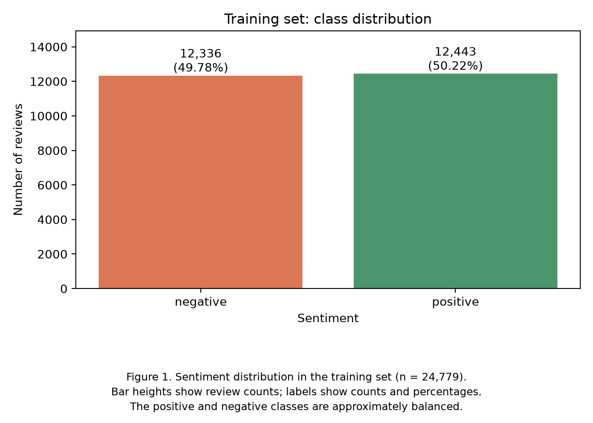
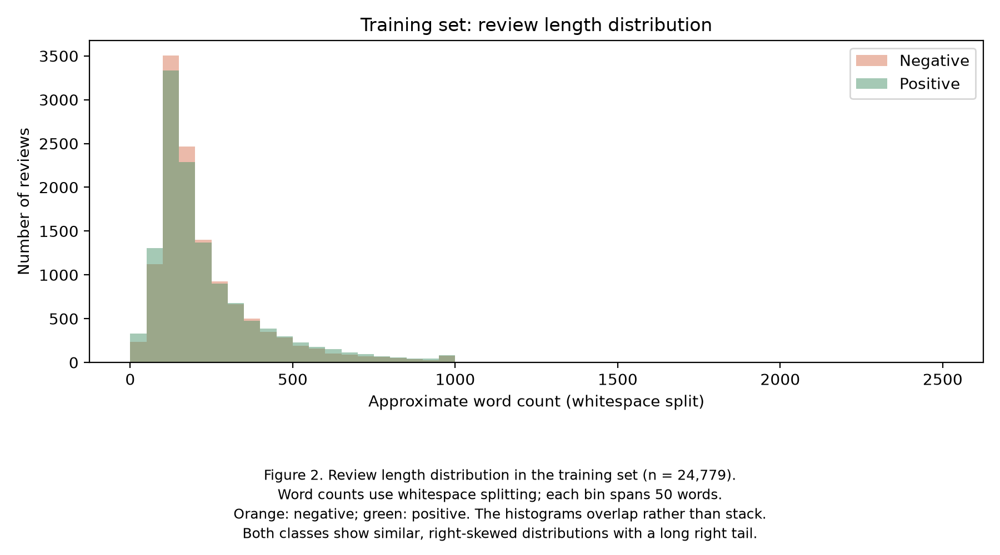
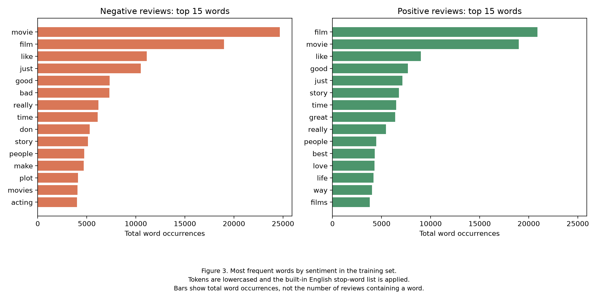

# Training-set Exploratory Data Analysis

## Purpose

Explore class balance, review lengths, and frequent words before training the classification models.

## Data and method

- Input: `data/processed/train.csv`.
- Training reviews: 24,779.
- Distinct movies: 3,425.
- Existing folds: 10, assigned by the shared data preparation pipeline.
- Script: `scripts/naive_bayes_eda.py`.
- This EDA reads only the processed training set.

Approximate word counts are calculated by splitting review text at whitespace. Character counts include spaces and punctuation.

For word-frequency analysis, `CountVectorizer` converts tokens to lowercase and applies its built-in English stop-word list. Frequencies count total token occurrences, including repeated occurrences within a review. These token counts differ from the whitespace-based review-length counts.

## 1. Class distribution

| Sentiment | Reviews | Percentage |
| --- | ---: | ---: |
| Negative | 12,336 | 49.78% |
| Positive | 12,443 | 50.22% |
| Total | 24,779 | 100.00% |

The two classes are approximately balanced.



## 2. Review lengths

| Statistic | Approximate word count | Character count |
| --- | ---: | ---: |
| Mean | 231.7 | 1,303.6 |
| Standard deviation | 172.1 | 986.4 |
| Minimum | 10 | 52 |
| 25th percentile | 126 | 694 |
| Median | 173 | 965 |
| 75th percentile | 281 | 1,583 |
| 95th percentile | 593 | 3,382.1 |
| Maximum | 2,459 | 13,593 |

Review lengths are right-skewed. Most reviews are relatively short, while a small number of long reviews increase the mean above the median. Approximately 95% of reviews contain no more than 593 whitespace-separated words.

### Word counts by sentiment

| Sentiment | Mean | Median | Minimum | Maximum |
| --- | ---: | ---: | ---: | ---: |
| Negative | 228.6 | 173 | 10 | 1,491 |
| Positive | 234.8 | 173 | 12 | 2,459 |

Positive reviews have a slightly higher mean word count, but both classes have the same median. Their length distributions overlap substantially. These descriptive results do not establish whether review length is useful for classification.

The histogram uses 50-word bins. Orange represents negative reviews and green represents positive reviews. The two distributions overlap; their heights are read separately.



## 3. Frequent words by sentiment

The figure shows the 15 most frequent tokens in each class after lowercasing and English stop-word removal.

- `movie` and `film` are frequent in both classes, reflecting the shared topic.
- The negative top-15 list includes `bad` with 7,315 occurrences.
- The positive top-15 list includes `great` with 6,388 occurrences, `best` with 4,303, and `love` with 4,281.
- `good` occurs frequently in both classes: 7,335 times in negative reviews and 7,692 times in positive reviews.

High frequency alone does not show that a word distinguishes the classes. For example, negative reviews may contain negation or mixed opinions.

The charts use the same horizontal scale. Bar lengths represent total occurrences, rather than the number of reviews containing each word.



## 4. Limitations and implications for modelling

The word-frequency analysis uses individual tokens and does not preserve their surrounding context or order.

The English stop-word list removes negation words such as `not`. Default tokenisation can also produce fragments: for example, `don't` can produce `don`.

These settings describe the current EDA only. The classification experiments should separately define and evaluate their preprocessing choices, including the treatment of negation.

During cross-validation, model vectorizers must be fitted on each training fold and then applied to its validation fold.

## Reproduce the analysis

From the repository root, run:

```powershell
.\.venv\Scripts\python.exe scripts/naive_bayes_eda.py
```

The script prints the statistics and saves:

- `documentation/week6/figures/class_distribution.png`
- `documentation/week6/figures/review_length_distribution.png`
- `documentation/week6/figures/top_words_by_sentiment.png`