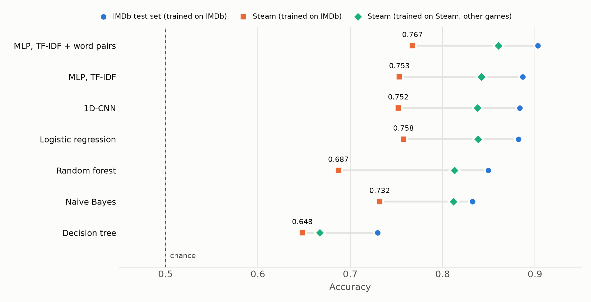
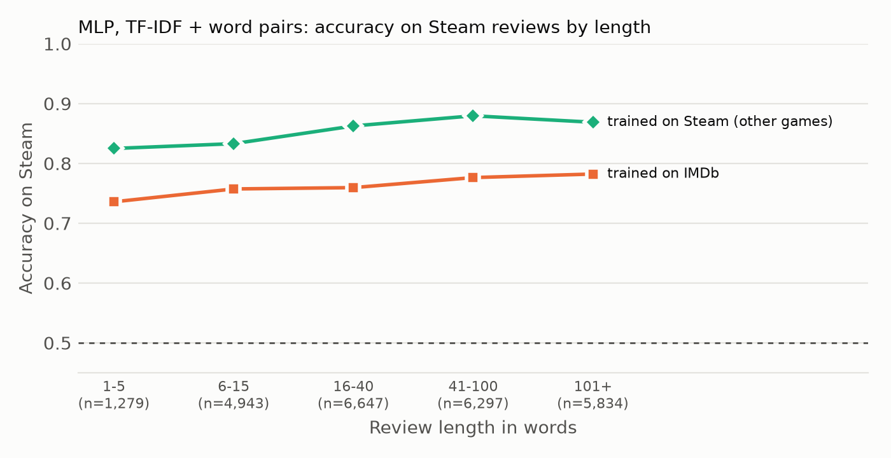

# Extra work: do our IMDb models work on Steam game reviews?

This is extra work (an exploratory study), done in collaboration with GenAI (Claude Opus 5.5).

Done after the report was submitted; it is not part of the report. The Steam
data and the samples built from it are not in git (size and licence):
`scripts/pre_steam.py` rebuilds them from the downloaded file.

## Question

The report's models were trained and tested on IMDb movie reviews. How well do
the same final models, trained on the same 24,779 IMDb reviews, judge Steam
game reviews they were never built for? And how much of any drop is caused by
the change of site rather than by Steam reviews simply being harder?

## Data

Antoni Sobkowicz (2017) *Steam Review Dataset (2017)* [Data set]. Zenodo.
https://doi.org/10.5281/zenodo.1000885. Licence: CC BY-NC 4.0. Kaggle's
`andrewmvd/steam-reviews` is a copy of the same data. One file,
`steam.csv.bz2` (505.9 MB), no header; columns `app_id, review_text,
review_score (1 = recommended, -1 = not recommended), review_votes`.

The label is the reviewer's thumbs up or down, not a star rating as on IMDb.

`scripts/pre_steam.py`:

1. Keep a seeded random 20% of rows (to save memory).
2. Strip spaces; drop empty reviews and the "Early Access Review" placeholder.
3. Drop reviews that are not mostly ASCII (other languages, ASCII art) or have
   no letters; drop repeated texts.
4. Split games 50/50 at random into halves A and B, so no game is in both.
5. In each half keep at most 15 reviews per game and class (IMDb caps a movie
   at 30 reviews), then draw equal numbers of positive and negative reviews.

Half A is the evaluation set (`data/steam_eval.csv`); half B (`data/steam_train.csv`)
is used only for the in-domain reference below.

What the file holds (`data/steam_stats.csv`): 6,417,106 reviews, 82.0% of them
recommended; 1,024,687 (16.0%) are the "Early Access Review" placeholder and
7,491 are empty. After the 20% draw, filters and de-duplication 993,430 reviews
remain. Each sample has 12,500 positive and 12,500 negative reviews:
the evaluation set covers 3,102 games, the in-domain training set 3,112 other games.
The download matched the md5 on the Zenodo page.

## Method

`scripts/cross_domain.py` rebuilds each model with its final setting from the
group's scripts (the MLP and CNN are imported from `scripts/mlp.py` and
`scripts/cnn.py`):

| Model | Setting |
| --- | --- |
| Naive Bayes | group TF-IDF, `alpha=1.0` |
| Logistic regression | group TF-IDF, `max_iter=1000` |
| Decision tree | group TF-IDF, `max_depth=20, min_samples_leaf=20` |
| Random forest | group TF-IDF, 500 trees, `max_depth=200, min_samples_leaf=2` |
| MLP | TF-IDF, 64 hidden units, 8 epochs; or TF-IDF + word pairs, 6 epochs |
| 1D-CNN | 600 tokens, filters of width 3/4/5, 6 epochs |

**Check that the rebuild is the group's model.** Trained on folds 1-9 and scored
on fold 0, every model reproduces the fold-0 accuracy in `results/scores/` exactly:

| Model | Fold 0, rebuilt | Fold 0, group score file |
| --- | --- | --- |
| Naive Bayes | 0.8311 | 0.8311 |
| Logistic regression | 0.8753 | 0.8753 |
| Decision tree | 0.7262 | 0.7262 |
| Random forest | 0.8510 | 0.8510 |
| MLP, TF-IDF | 0.8789 | 0.8789 |
| MLP, TF-IDF + word pairs | 0.8951 | 0.8951 |
| 1D-CNN | 0.8842 | 0.8842 |

**Cross-domain test.** Each model is trained on all 24,779 IMDb training reviews
and predicts the Steam evaluation set once. Scores use the same formulas and the
0.5 threshold as `scripts/evaluate.py`. Nothing was tuned on Steam.

**In-domain reference.** The same settings, trained instead on Steam reviews of
the *other* half of the games (`steam_train.csv`, about as many reviews as the
IMDb training set) and tested on the same evaluation set. The gap between the two
is the cost of changing site; the in-domain score shows how hard Steam reviews are
in themselves.

The IMDb test set was not read; its accuracies below are copied from
`results/scores/test/`.

## Results



| Model | IMDb test | Steam, trained on IMDb | Drop (points) | Steam, trained on Steam | Steam ROC-AUC (IMDb-trained) | Share predicted positive | Recall on negatives |
| --- | --- | --- | --- | --- | --- | --- | --- |
| MLP, TF-IDF + word pairs | 0.903 | **0.767** | 13.6 | 0.860 | 0.868 | 58.8% | 0.679 |
| Logistic regression | 0.882 | 0.758 | 12.4 | 0.838 | 0.849 | 56.2% | 0.696 |
| MLP, TF-IDF | 0.887 | 0.753 | 13.4 | 0.842 | 0.851 | 57.8% | 0.675 |
| 1D-CNN | 0.884 | 0.752 | 13.2 | 0.838 | 0.837 | 53.9% | 0.713 |
| Naive Bayes | 0.832 | 0.732 | 10.0 | 0.812 | 0.817 | 40.7% | 0.825 |
| Random forest | 0.849 | 0.687 | 16.2 | 0.813 | 0.789 | 71.8% | 0.469 |
| Decision tree | 0.730 | 0.648 | 8.1 | 0.667 | 0.711 | 70.9% | 0.439 |

Full numbers: `results/summary.csv`; by length: `results/by_length.csv`.

1. **Every model loses 8-16 points on Steam**; the best, the word-pair MLP,
   gets about one Steam review in four wrong (0.767). The ranking barely changes:
   the word-pair MLP is best and the decision tree worst in all three settings.
2. **About two thirds of the drop is the change of site, one third is Steam being
   harder.** Trained on Steam reviews of other games, the same settings reach
   0.81-0.86 (decision tree 0.67), still 2-6 points below their IMDb test scores.
   So the cost of moving from IMDb to Steam is about 8-9 points for the four best
   models (12.6 for the random forest).
3. **The IMDb models miss negative Steam reviews.** On a balanced set, all but
   Naive Bayes call 54-72% of reviews positive; the random forest and the tree
   find fewer than half of the negatives. Naive Bayes leans the other way, as on IMDb.
4. **Unknown words are not the problem; known words with another meaning are.**
   Only 2.3% of Steam word tokens are missing from the IMDb vocabulary (`dlc`,
   `devs`, `platformer`, `replayability`, `laggy`, `framerate`...). What hurts is
   that words used for game complaints are almost neutral in IMDb. Logistic
   regression weights, IMDb vs Steam (`results/vocabulary_shift.txt`):

   | Word | IMDb | Steam | | Word | IMDb | Steam |
   | --- | --- | --- | --- | --- | --- | --- |
   | refund | -0.05 | -4.46 | | addictive | +0.41 | +3.27 |
   | unplayable | -0.05 | -4.18 | | challenging | +0.14 | +2.47 |
   | crashes | -0.34 | -3.66 | | cheap | -2.40 | +0.48 |
   | repetitive | -0.54 | -3.70 | | problem | -2.31 | +0.52 |
   | controls | -0.05 | -2.74 | | awesome | +2.18 | +5.31 |
   | buggy | -0.13 | -2.65 | | bad | -7.71 | -3.45 |

   A film is not "unplayable" and does not "crash"; a game that is "addictive"
   or "challenging" is praised; "cheap" is about the price, not the production.
5. **Short reviews are harder**, more so for models trained on IMDb, whose reviews
   are long. The CNN, which reads windows of 3-5 words, falls furthest: 0.683 on
   reviews of 1-5 words against 0.788 on reviews over 100 words.

   

6. **4.6% of Steam reviews fool every IMDb model** (79% of them negative); a
   logistic regression trained on Steam gets 39.5% of those right. Reading
   a random 20 (`results/examples.txt`), they fall into four kinds:
   - technical complaints with no sentiment words ("this game is not working it
     keeps saying pixel error");
   - comparisons ("not as good as first game...", "Zelda without the charm.");
   - sarcasm ("game of the year. so original and unique. wow.");
   - joke recommendations whose label is positive but whose text is negative
     ("I got this game as a joke gift. They had no idea."). These are label noise:
     no text model can get them right, and they cap even the Steam-trained models.

**In short:** the models from the report still work on game reviews, far above
chance, but the best of them misjudges one Steam review in four, mostly negative
reviews about bugs, crashes and refunds that IMDb never taught them. Before using
them on another site, they would need at least some labelled reviews from that site.

## Limits of this check

- One random draw (seed 42); no repeated samples or confidence intervals.
- "English" is the reviewer's own setting; the ASCII filter removes other
  scripts but not English-looking text in other languages.
- Steam's label is a thumbs up or down, and some are jokes; IMDb's is a star
  rating with neutral 5-6 reviews removed. Part of the drop is this difference.
- The in-domain reference uses the IMDb settings unchanged; tuned for Steam it
  might do a little better.

## Reproduce

From the project folder, after putting `steam.csv.bz2` in `extra_work/data_raw/`:

```
.venv\Scripts\python.exe extra_work\scripts\pre_steam.py
.venv\Scripts\python.exe extra_work\scripts\cross_domain.py --check
.venv\Scripts\python.exe extra_work\scripts\cross_domain.py --steam --models mnb_tfidf lr_tfidf dt_tfidf rf_tfidf
.venv\Scripts\python.exe extra_work\scripts\cross_domain.py --steam --models mlp_tfidf
.venv\Scripts\python.exe extra_work\scripts\cross_domain.py --steam --models mlp_tfidf_bigram
.venv\Scripts\python.exe extra_work\scripts\cross_domain.py --steam --models cnn
.venv\Scripts\python.exe extra_work\scripts\cross_domain.py --in-domain   (same four calls)
.venv\Scripts\python.exe extra_work\scripts\analyse.py
```

Run each neural network in its own process, as the original scripts do.

## GenAI

This is extra work (an exploratory study), done in collaboration with GenAI (Claude Opus 5.5).
